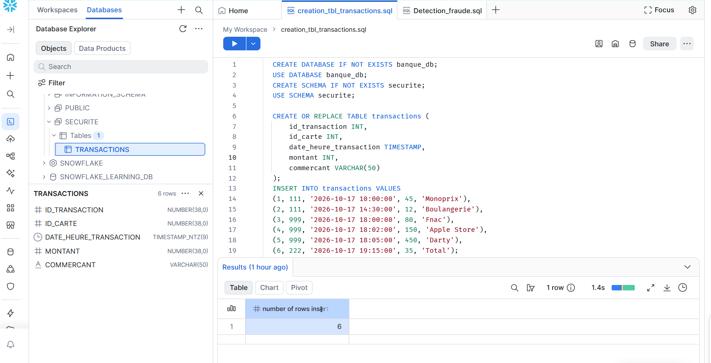
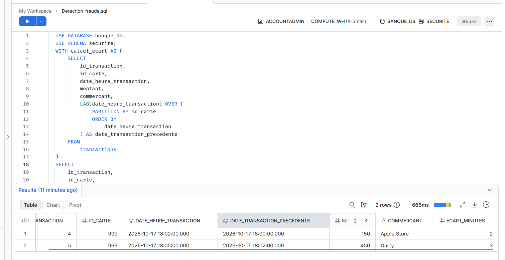

# Detection automatisee de fraude bancaire (Velocity Attack)

## Contexte Metier
Ce projet simule le role d'un Data Analyst au sein d'une equipe Cybersecurite et Risques d'une banque en ligne. L'objectif est d'identifer de maniere automatisee les fraudes de type "Velocity Attack", ou une carte bancaire volee est utilisee pour realiser plusieurs transactions consecutives dans un intervalle de temps tres court (moins de 10 minutes).

## Stack Technique
* Cloud Infrastructure : Amazon Web Services (AWS)
* Data Warehouse : Snowflake (Interface Snowsight)
* Langage : SQL Avance (Fonctions analytiques de fenetrage)

## Logique de l'Analyse SQL
Le script utilise la fonction analytique LAG() associee a une clause PARTITION BY pour isoler l'historique de chaque carte bancaire. La fonction DATEDIFF() calcule ensuite l'ecart temporel en minutes entre la transaction active et la transaction precedente. Un filtre strict (WHERE) isole uniquement les lignes ou cet ecart est compris entre 0 et 10 minutes.

## Conclusions du Projet
L'execution de la requete sur le jeu de donnees de test a permis d'isoler deux transactions frauduleuses emises en moins de 3 minutes d'intervalle pour des montants escalatoires (150 EUR et 450 EUR), permettant le declenchement theorique d'une alerte de blocage de carte.

# Appercu de la table Transaction

# Ecart Fraude

